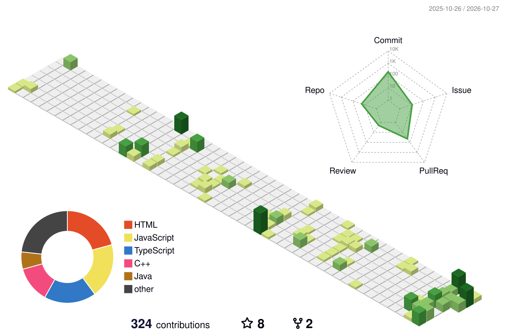

<!-- ===================== PROFILE LAYOUT ===================== -->
<table>
  <tr>
    <td width="60%" align="center" valign="middle">
      
    </td>
    <td width="40%" align="center" valign="top">
      <h3>Tech Stack</h3>
      
<strong>Languages</strong>

       
      
      
<strong>Frontend & Backend</strong>

       
      
      
<strong>Databases, Tools & Platforms</strong>

       
       
      
    </td>
  </tr>
</table>

### Building useful things, learning deeply, and contributing to open source.

I'm **Utkarsh Rawat**, a Computer Science and Engineering student at **IIIT Una** interested in full-stack development, backend engineering, and open-source contributions. I build applications using **React, TypeScript, Node.js, Express, MongoDB, and Spring Boot**, while strengthening my skills in **Java, databases, DSA, and competitive programming**.

---

  

